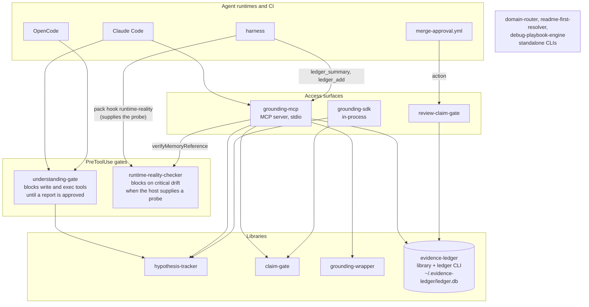

# Architecture

Agents reach the `agent-grounding` stack two ways: **PreToolUse hooks** that block destructive tools until an Understanding Report is approved (`understanding-gate`) or, when the host supplies a process probe, on critical runtime drift (`runtime-reality-checker`); and **access surfaces** (an MCP server, an in-process SDK, and CLIs) for evidence, claims and hypotheses. The evidence ledger is the store behind `grounding-mcp`, `review-claim-gate` and the `ledger` CLI.

The diagram shows which package calls which, and which one owns the ledger store. An arrow means a runtime import or call; type-only imports are not drawn.

`claim-gate` and `hypothesis-tracker` do not read the ledger themselves. `grounding-mcp` derives claim-gate's inputs from the ledger and the session phases (`claim_evaluate_from_session`) and keeps hypotheses in its own JSON files. `grounding-sdk` takes a ledger summary from its caller instead of opening the ledger.

## Why this exists

AI agents are good at generating plausible explanations. They're bad at verifying them. This framework enforces discipline:

- **Don't assume**: check runtime state before diagnosing.
- **Don't claim**: gate strong assertions behind evidence.
- **Don't forget**: track all hypotheses, don't silently drop them.
- **Don't skip steps**: follow diagnostic playbooks in order.
- **Don't guess scope**: route to the correct domain first.

The motivating incident lives in an internal logbook: an agent investigated two `agent-grounding` tasks against a checkout that was 16 commits behind origin, declared both "stale" because the relevant directories didn't exist locally, and only caught the drift hours later when a third task forced a fresh `git pull`. Two corrections had to be walked back. The check that would have caught it is `git fetch && git status` before any structural claim. No package here runs it: `claim-gate` can require an agent to declare its checks before an architecture or root-cause claim (the declarations are self-reported), and `runtime-reality-checker` compares running processes, not checkout freshness.

## Where this fits

`agent-grounding` is part of the agent runtime layer of the [Project OS toolchain](https://github.com/LanNguyenSi/project-pilot/blob/main/docs/ecosystem.md): it verifies agents at every lifecycle stage rather than at one.

- [agent-planforge](https://github.com/LanNguyenSi/agent-planforge) plans
- [agent-tasks](https://github.com/LanNguyenSi/agent-tasks) coordinates
- [agent-preflight](https://github.com/LanNguyenSi/agent-preflight) validates before push (the Validate stage)
- **agent-grounding** verifies agents at every stage, next to harness
- [harness](https://github.com/LanNguyenSi/harness) declares + enforces the policy boundary that calls into all of the above

## Trust model and failure modes

What each gate trusts, what it does when its own inputs fail, and how an operator overrides it:

- **understanding-gate**: trusts the `approvalStatus` of the latest persisted Understanding Report for the active task, which the `understanding-gate` CLI sets. A write or exec tool without an approved report is blocked, also when the report directory cannot be read; a malformed hook payload degrades to allow with a stderr diagnostic and a `degraded_allow` audit entry. Overrides: `UNDERSTANDING_GATE_DISABLE`, `UNDERSTANDING_GATE_FORCE` with a `UNDERSTANDING_GATE_FORCE_REASON` of at least 10 characters, and the pause sentinel named by `UNDERSTANDING_GATE_PAUSE_FILE`. See [gate behavior](../packages/understanding-gate/docs/gate-behavior.md) and [pause sentinel](../packages/understanding-gate/docs/pause-sentinel.md).
- **runtime-reality-checker**: trusts the operator's expectations file and the host's probe output. It fails open on every load, parse, keyword, expectations and probe error, and denies only on critical drift or when an escalation variable asks for it. Overrides: `RUNTIME_REALITY_DISABLE`, `RUNTIME_REALITY_CRITICAL_AS_WARN`, `RUNTIME_REALITY_WARN_AS_BLOCK`, `RUNTIME_REALITY_PROBE_FAIL_BLOCK`. See [policy-runtime-reality.md](policy-runtime-reality.md).
- **claim-gate**: trusts caller-supplied booleans and reads no store, so it is a self-discipline aid, not a merge gate. See [claim-gate vs review-claim-gate](okf/claim-gate-vs-review-claim-gate.md).
- **review-claim-gate** (`merge_approval`): fails closed unless all five prerequisites are true. In CI they come from `review:*` labels applied by a reviewer, or from the pure-release exception; `evidence_logged` can also come from a committed evidence file. See [merge-approval gate mechanics](okf/merge-approval-gate-mechanics.md).
- **solution acceptance** (`grounding-mcp` `solution_gate`): passes only for a `ready` verdict produced at the current git HEAD and stored outside the agent-writable ledger, with a documented residual forgeability. See [solution-acceptance verdict contract](okf/solution-acceptance-verdict-contract.md).

## Restricted documentary assessment producer

The `grounding-mcp` package also supplies `grounding-assessment-mcp`, a separate seven-tool stdio entrypoint for portable signed documentary assessments. It requires explicit issuer configuration and uses its own assessment store. See [configuration, tools, and activation boundaries](../packages/grounding-mcp/docs/grounding-receipt-codec.md#restricted-assessment-mcp). The existing `grounding-mcp` session, ledger, and verdict tools retain their current contract.
