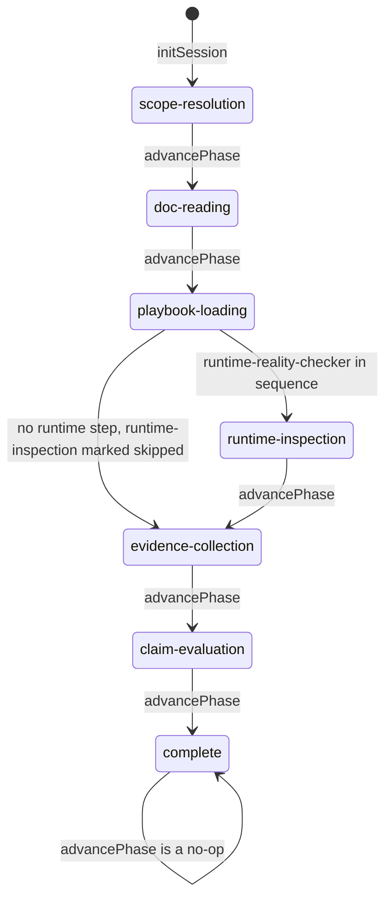

# Grounding phase model and claim-context derivation

A grounding session tracks *phase progress*, not *checks performed*. claim-gate's
`ClaimContext` has six boolean flags; inside a session they are derived from which
phases are `done` or `skipped` and from the ledger, never from a record that a
process, config or health check actually ran. An agent that reads
`process_checked: true` as "a process check happened" is wrong whenever the
runtime phase was skipped.

## The phase machine (grounding-wrapper)

`GroundingPhase` has seven values, in this order
(`packages/grounding-wrapper/src/lib.ts:13-20#"| 'complete';"`):
`scope-resolution`, `doc-reading`, `playbook-loading`, `runtime-inspection`,
`evidence-collection`, `claim-evaluation`, `complete`. `initSession` marks
`scope-resolution` active and every other phase pending
(`packages/grounding-wrapper/src/lib.ts:227#"phaseStatus['scope-resolution'] = 'active';"`).

Which phases have steps depends on the keyword:

- The tool sequence always contains domain-router, readme-first-resolver,
  debug-playbook-engine, evidence-ledger, claim-gate and hypothesis-tracker.
  runtime-reality-checker is spliced in only when the lowercased keyword
  contains `monitor`, `agent`, `service`, `server` or `gateway`
  (`packages/grounding-wrapper/src/lib.ts:139-148#"base.splice(3, 0, 'runtime-reality-checker');"`).
- Each tool maps to one phase. hypothesis-tracker shares
  `evidence-collection` with evidence-ledger and is the only non-mandatory
  step (`packages/grounding-wrapper/src/lib.ts:189-192#"mandatory: false,"`).
- So `runtime-inspection` is the only phase that can have no steps.

`advancePhase` marks the current phase `done`, then walks forward and marks
every phase without steps `skipped` until it finds one with steps; reaching the
end sets `complete`, which is also marked `done`. At `complete` it is a no-op
(`packages/grounding-wrapper/src/lib.ts:246-275#"session.phase_status.complete = 'done';"`).
It checks nothing else: no tool output, no ledger entry. grounding-mcp's
`grounding_advance` loads the session, calls `advancePhase` and saves it
(`packages/grounding-mcp/src/server.ts:724-732#"advancePhase(s);"`), so a phase
is `done` because the caller said so.

The state diagram shows the transitions `advancePhase` can make; the edge from
`playbook-loading` straight to `evidence-collection` is the skip taken when
runtime-reality-checker is not in the sequence.

A scope change does not edit a session: `handleScopeChange` builds a fresh
session (new id, new sequence, phases reset) with `scope_changed: true`
(`packages/grounding-wrapper/src/lib.ts:282-288#"return { ...newSession, scope_changed: true };"`).

## Guardrails are labels, not gates

`resolveGuardrails` always returns `no-root-cause-before-readme`,
`no-step-skipping`, `no-architecture-claim-before-docs` and
`no-network-claim-before-process-check`, and adds
`no-token-claim-before-config-check` only for keywords containing `token`,
`auth`, `config`, `monitor`, `dashboard` or `agent`
(`packages/grounding-wrapper/src/lib.ts:101-123#"return [...new Set(rails)];"`).
The only consumer is `isGuardrailActive`, a membership test
(`packages/grounding-wrapper/src/lib.ts:297-299#"return session.active_guardrails.includes(guardrail);"`),
exposed as `grounding_guardrail_check`. Neither the phase machine nor the
context derivation reads `active_guardrails`; a claim is judged by claim-gate's
per-type prerequisites alone.

## Context derivation: two hand-kept copies

grounding-mcp (`claim_evaluate_from_session`) and grounding-sdk (`validate`)
derive the same `ClaimContext`:

| ClaimContext flag | Derived from |
|---|---|
| `readme_read` | `doc-reading` is `done` or `skipped` |
| `process_checked`, `config_checked`, `health_checked` | `runtime-inspection` is `done` or `skipped` (all three from the one phase) |
| `has_evidence` | the session's ledger summary has at least one fact |
| `alternatives_considered` | the ledger summary has at least one rejected entry |

grounding-mcp's copy is `packages/grounding-mcp/src/derive-context.ts:16-34#"alternatives_considered: ledgerSummary.rejected.length > 0,"`,
called with the session and its ledger summary
(`packages/grounding-mcp/src/server.ts:888#"const context = deriveContext(session, summary);"`).
grounding-sdk's copy is
`packages/grounding-sdk/src/index.ts:150-182#"alternatives_considered: (summary?.rejected.length ?? 0) > 0,"`; its
comment states that it mirrors the MCP file and is kept in sync manually so the
SDK does not depend on the server package. The copies differ in one input: the
SDK's ledger summary is optional and a missing summary yields
`has_evidence: false` and `alternatives_considered: false`
(`packages/grounding-sdk/src/index.ts:181-182#"alternatives_considered: (summary?.rejected.length ?? 0) > 0,"`).
A change to the phase model or the mapping has to land in both files.

claim-gate treats an absent or false flag as missing
(`packages/claim-gate/src/lib.ts:126#"const missing = policy.requires.filter((req) => !context[req]);"`),
and its per-type prerequisite table decides the verdict
(`packages/claim-gate/src/lib.ts:50#"export const POLICIES: ClaimPolicy[] = ["`).

## The consequence: skipped counts as checked

`skipped` counts as satisfied because a phase without steps would otherwise
deadlock the claim (the rationale comment at
`packages/grounding-mcp/src/derive-context.ts:4-8#"so requiring it as a prerequisite would be a deadlock."`).
Combined with the keyword rule above, a session whose keyword names none of the
five runtime words reports `process_checked`, `config_checked` and
`health_checked` as true as soon as it has been advanced past
`playbook-loading`, without any runtime inspection. A `network` or
`availability` claim (both require only `health_checked` and `process_checked`)
is then allowed. With a runtime keyword the same three flags stay false until
`runtime-inspection` itself is advanced. In both cases the flags say the phase
was passed, not which of the three checks ran.

## A third, frozen copy for receipts

The grounding-receipt assessment does not use either function. It has its own
frozen evaluator that recomputes the phase plan, the claim type and the
prerequisite table from completion events in the assessment store
(`packages/grounding-mcp/src/grounding-assessment-policy.ts:70-81#"alternatives_considered: snapshot.entries.some("`).
It applies the same skip rule in its own terms: without a runtime step,
`runtime-inspection` counts as completed once a `playbook-loading` event
exists. Changing claim-gate's table or the live phase model does not change
this evaluator; see [Grounding receipt codec contract](grounding-receipt-contract.md)
for why its policy is pinned.
