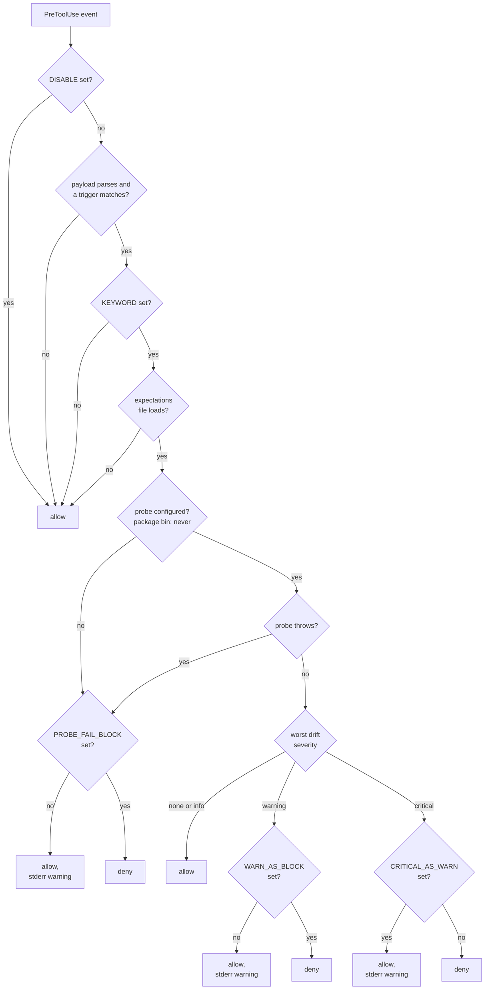

# runtime-reality-checker as a harness PreToolUse policy

This doc specifies the design for wiring `@lannguyensi/runtime-reality-checker` as a harness `PreToolUse` policy. The policy code lives in `packages/runtime-reality-checker/src/policy/`. The package's own bin `runtime-reality-policy-pre-tool-use` ships without a probe, so on its own it never blocks on drift; the harness integration `harness pack hook runtime-reality` supplies the probe.

The point: without a PreToolUse hook that supplies a probe, nothing in a live session calls `runRealityCheck`. As a result, an agent can confidently issue a `docker-compose down` command on a host where half the expected services are already missing, then "diagnose" against a runtime state that no longer matches the documentation. This policy fixes that by running a drift check before destructive runtime commands, and blocking when critical drift exists.

## Trigger set

A `PreToolUse` event fires for every tool call. The policy is short-circuited to allow for tools that cannot affect runtime state (e.g. `Read`, `Grep`, MCP queries). The policy is engaged only when the tool call **matches a trigger**.

Triggers are pattern-based on `tool_name + tool_input`. The package ships a hard-coded default trigger set (see `src/policy/triggers.ts`) and supports operator overrides via `RUNTIME_REALITY_TRIGGERS_FILE`.

### Trigger file override

Set `RUNTIME_REALITY_TRIGGERS_FILE=<absolute-path>` to replace the default trigger set at startup. The file must be a JSON array of trigger objects:

```json
[
  {
    "toolNames": ["Bash"],
    "commandPattern": "kubectl\\s+(delete|apply|rollout restart)\\b",
    "category": "deploy-script"
  }
]
```

Each element requires:
- `toolNames`: a non-empty array of tool name strings (case-sensitive, e.g. `"Bash"`)
- `commandPattern`: a string compiled to a `RegExp` at load time
- `category`: one of the four valid categories: `compose-mutation`, `systemctl-mutation`, `process-kill`, `deploy-script`

The file is read once at hook startup, not hot-reloaded. The 1 MiB size cap (`MAX_TRIGGERS_BYTES`) applies. Any load, parse, shape, or regex failure causes the policy to fall back to `DEFAULT_TRIGGERS` and write a warning to stderr (fail-open). Custom categories and per-keyword trigger overrides are out of scope.

Each `commandPattern` is compiled to a `RegExp` and tested synchronously against command strings inside the hook. Unlike the fixed, audited `DEFAULT_TRIGGERS`, an override pattern is operator-supplied, so keep it simple: a pathological pattern with nested quantifiers could backtrack catastrophically and stall the hook. This is the same operator-trust tier as the expectations dir, so it is an accepted residual rather than a sandboxed input.

| Trigger category   | Matches when                                                                                                                                                | Rationale                                                                                                                                |
| ------------------ | ----------------------------------------------------------------------------------------------------------------------------------------------------------- | ---------------------------------------------------------------------------------------------------------------------------------------- |
| compose-mutation   | `tool_name=Bash` AND command matches a docker / docker-compose invocation with an `up`, `down`, `restart`, `stop`, `kill`, or `rm` action (flags allowed in between) | Compose-driven services are the canonical multi-process runtime in this repo family. A drifted compose-state turns "restart" into "rebuild from wrong starting point". |
| systemctl-mutation | `tool_name=Bash` AND command matches `/systemctl(\s+--[\w=-]+)*\s+(restart|stop|disable|enable|start)\b/`                                                   | systemd-managed services on the VPS. Restarting against a wrong expected-startup-mode silently swaps `manual` for `systemd`.             |
| process-kill       | `tool_name=Bash` AND command matches `/\bkill\s+(-\d+\s+|-[A-Z]+\s+)?\d+\b/` or `pkill`                                                                     | Killing a PID that doesn't match the documented expectation usually means an out-of-band copy got started.                              |
| deploy-script      | `tool_name=Bash` AND command contains `./deploy-` or `./deploy_` (at the start or after whitespace), or matches `/bash\s+[^\s]*deploy[^\s]*\.sh\b/`                | Repo-local deploy wrappers always touch the production process set.                                                                      |

Tool calls that don't match any trigger are passed through silently (no check, no log).

## Expectations file

Each domain (keyword) has a JSON file describing what processes are expected. Default path: `~/.runtime-reality/expectations/<keyword>.json`, override via `RUNTIME_REALITY_EXPECTATIONS_DIR`.

```json
{
  "domain": "deploy-panel",
  "processes": [
    { "name": "panel-api",      "expected_startup": "docker", "expected_port": 3001 },
    { "name": "panel-frontend", "expected_startup": "docker", "expected_port": 3000 },
    { "name": "agent-relay",    "expected_startup": "docker", "expected_port": 4040 }
  ]
}
```

The shape matches `ExpectedProcess[]` from `@lannguyensi/runtime-reality-checker`. No new types.

The keyword comes only from `RUNTIME_REALITY_KEYWORD`. If it is unset, the policy degrades to allow (there is no expected baseline to compare against). A lookup by `grounding-mcp` session id is not implemented.

## Actuals probe

The check needs an `ActualProcessState[]`. Computing it is host-specific:

- For Docker hosts: `docker ps --format '{{json .}}'` plus port-mapping parse
- For systemd hosts: `systemctl list-units --type=service --state=running`
- For local dev: `ps -ef | grep <name>` per expected process

This package ships a **probe interface**, not a probe implementation, because the right probe depends on where the policy runs:

- This package does not read `RUNTIME_REALITY_PROBE_CMD`. Its bin passes no probe to the handler.
- The harness hook (`harness pack hook runtime-reality`) reads `RUNTIME_REALITY_PROBE_CMD`, runs that command, and passes the parsed `ActualProcessState[]` to this package's handler.
- harness ships a Docker probe script; see [harness: runtime-reality PreToolUse hook](https://github.com/LanNguyenSi/harness/blob/master/docs/runtime-reality-hook.md), section 3.
- With no probe, the handler writes a warning to stderr and allows, or denies when `RUNTIME_REALITY_PROBE_FAIL_BLOCK=1`.

This keeps the agent-grounding repo free of host-coupling.

## Severity to decision mapping

The library emits drift items with severity `critical | warning | info`. The policy maps them to a `PreToolUse` hookSpecificOutput decision:

| Worst drift severity | Default policy decision | Operator-overridable via |
| -------------------- | ----------------------- | ------------------------ |
| (no drift)           | `allow` (silent)        | n/a                      |
| `info`               | `allow` (silent)        | n/a                      |
| `warning`            | `allow` + stderr warning that names the drift items | `RUNTIME_REALITY_WARN_AS_BLOCK=1` to escalate |
| `critical`           | `deny` + stderr message with "fix drift before continuing" | `RUNTIME_REALITY_CRITICAL_AS_WARN=1` to degrade |
| (probe failed)       | `allow` + stderr warning | `RUNTIME_REALITY_PROBE_FAIL_BLOCK=1` |

The flowchart shows the handler's order of checks. Every step before the drift comparison allows the call by default, so only a probe that reports critical drift, or an escalation variable, can deny. The package bin never configures a probe. Variable names drop the `RUNTIME_REALITY_` prefix: `DISABLE` stands for `RUNTIME_REALITY_DISABLE`, and so on.



The defaults are intentionally **fail-open**: the harness should never become a tarpit because a probe is misconfigured. The block-on-critical default exists because the cost of letting an agent operate against a wrong runtime model is usually higher than the cost of a false block (a false block can be lifted by setting `RUNTIME_REALITY_DISABLE=1`, or degraded to a warning with `RUNTIME_REALITY_CRITICAL_AS_WARN=1`; the false diagnosis cascades for hours).

## Concrete example: VPS compose deploy

```
Agent runs: docker-compose -f docker-compose.prod.yml restart panel-api

PreToolUse fires:
  tool_name = Bash
  tool_input.command = "docker-compose -f docker-compose.prod.yml restart panel-api"

Policy match: compose-mutation trigger

Expected (from ~/.runtime-reality/expectations/deploy-panel.json):
  - panel-api      (docker, port 3001)
  - panel-frontend (docker, port 3000)
  - agent-relay    (docker, port 4040)

Actual (from probe `docker ps --format json`):
  - panel-api      (docker, port 3001) ✓
  - agent-relay    (docker, port 4040) ✓
  - (panel-frontend not running)

Drift:
  critical: Process 'panel-frontend' expected to be running but is NOT

Decision: deny
Stderr: "runtime-reality-checker: drift detected for keyword 'deploy-panel' before 'compose-mutation' tool call
  - [critical] Process 'panel-frontend' expected to be running but is NOT
Fix the drift before continuing, or set RUNTIME_REALITY_DISABLE=1 to switch this hook off."
```

The agent now has to deal with the missing frontend before issuing the restart. Without this check, the agent would restart `panel-api`, observe nothing broke, and report success while the panel is still half-down.

## harness integration

Declare the hook as a harness `hooks:` entry that runs `harness pack hook runtime-reality`, with `RUNTIME_REALITY_KEYWORD`, `RUNTIME_REALITY_EXPECTATIONS_DIR` and `RUNTIME_REALITY_PROBE_CMD` set in its command; see [harness: runtime-reality PreToolUse hook](https://github.com/LanNguyenSi/harness/blob/master/docs/runtime-reality-hook.md) for the entry and the probe install.

This package also ships its own `runtime-reality-policy-pre-tool-use` bin (`packages/runtime-reality-checker/src/policy/pre-tool-use.ts`, compiled to `dist/policy/pre-tool-use.js`). The bin alone has no probe, so it never blocks on drift: a triggered call that reaches the probe step is allowed, or denied when `RUNTIME_REALITY_PROBE_FAIL_BLOCK=1`.

The harness hook passes only the expectations loader and the probe to the handler, so `RUNTIME_REALITY_TRIGGERS_FILE` and `RUNTIME_REALITY_AUDIT_LOG` take effect only with this package's own bin. The full env table is in [pretooluse-policy.md](../packages/runtime-reality-checker/docs/pretooluse-policy.md).

## Open questions

These are not decided yet:

1. **Keyword from a session id.** The keyword comes only from `RUNTIME_REALITY_KEYWORD`. Deriving it from a `grounding-mcp` session id is an unimplemented option; it would make the hook depend on grounding-mcp being installed, and would need a decision on whether the hook degrades to allow when grounding-mcp is missing.
2. **Probe failure observability.** Should probe failures also surface in `friction-log`? Today they produce a stderr warning and, with this package's own bin, an audit line. Probably friction-log, but that adds a dep.
3. **Multi-keyword sessions.** A session that touches both `deploy-panel` and `agent-relay` would need to merge two expectations files. Out of scope for now, real follow-up.
4. **Probe caching.** A fresh `docker ps` on every Bash call is 50-200ms overhead. The probe contract should declare cache-TTL; the harness wrapper can honor it.

## Out of scope

- Automatic discovery of `expected state` from running containers (would mean drift can never be detected because "expected" is whatever is running)
- Multi-host reality checks (the probe is local-host only)
- Editing the runtime-reality-checker library API itself (the policy wraps the existing surface)
- The harness-side hook registration and the probe script, which live in the `harness` project

## Related code

- Hook pattern reference: `packages/understanding-gate/src/adapters/claude-code/pre-tool-use.ts` (fail-open, thin entrypoint, pure handler)
