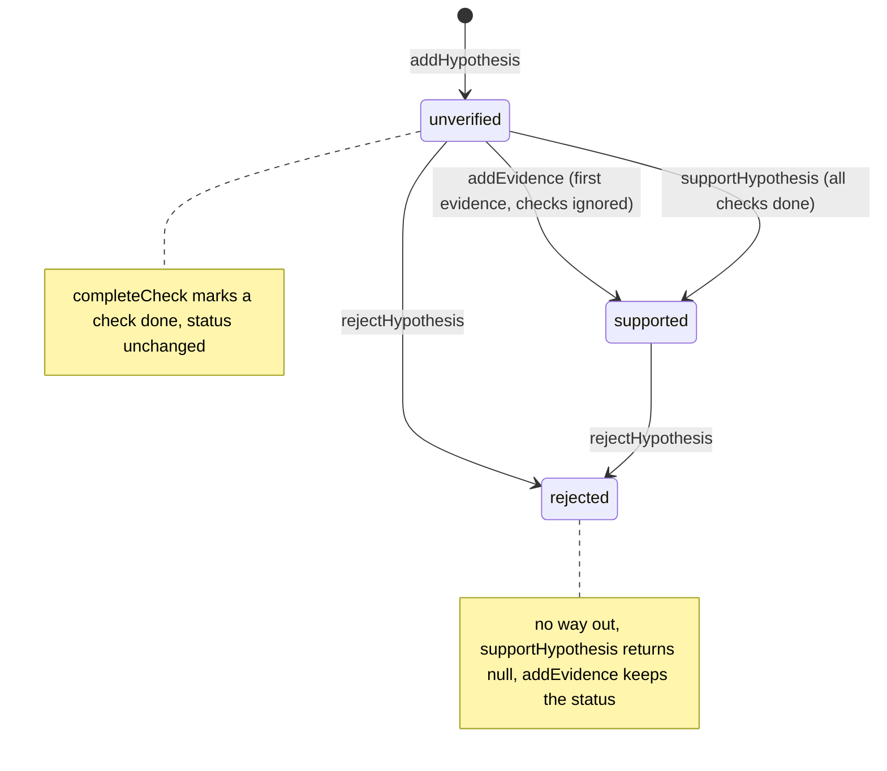

# hypothesis-tracker

Track competing hypotheses during debugging.

## Overview

hypothesis-tracker prevents agents from silently replacing one wrong guess with another: each hypothesis carries its own required checks, evidence entries and status (unverified, supported, or rejected), so a debugging session keeps a visible record of what was considered and why it was ruled in or out.

The store is a plain in-memory object; persist it yourself with `exportStore`/`importStore`.

## Install

```bash
npm install @lannguyensi/hypothesis-tracker
```

Requires Node.js >= 20.

## Usage

```typescript
import {
  createStore,
  addHypothesis,
  addEvidence,
  completeCheck,
  rejectHypothesis,
  supportHypothesis,
  getSummary,
} from "@lannguyensi/hypothesis-tracker";

// Create a session store
const store = createStore("debug-session-1");

// Add competing hypotheses with required checks
addHypothesis(store, "DNS resolution is failing", [
  "Run dig/nslookup",
  "Check /etc/resolv.conf",
]);

addHypothesis(store, "Firewall is blocking port 443", [
  "Check iptables rules",
  "Test with curl from host",
]);

// Record evidence (auto-promotes hypothesis from unverified to supported)
const h = store.hypotheses[0];
addEvidence(store, h.id, "dig example.com returns NXDOMAIN", "terminal");

// Complete verification checks
completeCheck(store, h.id, 0); // Mark first check as done

// Reject the other hypothesis with a reason
rejectHypothesis(store, store.hypotheses[1].id, "Firewall rules allow 443");

// Get summary
const summary = getSummary(store);
// { total: 2, supported: 1, rejected: 1, unverified: 0, pending_checks: 3 }
```

## Status lifecycle

The diagram shows how each function moves a hypothesis between the three statuses. Required checks gate only `supportHypothesis`; `addEvidence` promotes on the first evidence.



## API

| Function | Description |
|----------|-------------|
| `createStore(session?)` | Create new hypothesis store |
| `addHypothesis(store, text, checks)` | Add hypothesis with required verification steps |
| `findHypothesis(store, id)` | Find hypothesis by ID |
| `addEvidence(store, id, text, source?)` | Add evidence; the first evidence promotes an unverified hypothesis to supported even if checks are pending |
| `completeCheck(store, id, index)` | Mark a verification check as done |
| `supportHypothesis(store, id)` | Mark as supported without evidence; returns null (no change) while any required check is pending, or if the id is unknown or the hypothesis is rejected |
| `rejectHypothesis(store, id, reason?)` | Mark hypothesis as rejected |
| `getSummary(store)` | Get counts by status |
| `exportStore(store)` | Serialize store to JSON string |
| `importStore(json)` | Parse and validate a store from a JSON string; throws on invalid JSON or a malformed shape |

## Development

```bash
npm install
npm run build    # TypeScript build
npm test         # Run tests (vitest)
npm run lint     # Type check
```

## License

MIT
