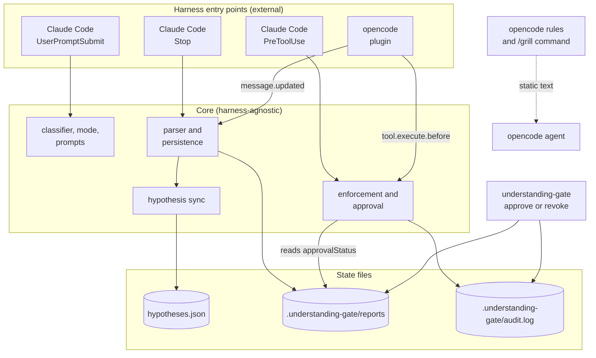

# understanding-gate Architecture

Reference for the package layers, harness entry points, lifecycle states and configuration surfaces.

Three-layer split: harness-agnostic Core, per-harness Adapters, the harnesses themselves. Core holds the decision logic and file-backed state helpers and has no harness dependency; Adapters translate harness payloads.

> Note: The harness-specific names below (Claude Code's `UserPromptSubmit`, opencode's `tool.execute.before`, etc.) are the implementation-side translation of the neutral "prompt hook" / "pre-tool hook" concepts from two earlier, unpublished design documents. Those documents do not name specific harness APIs; this mapping was made during the conversation that produced this package plan.

## Layered view

The flowchart shows every installed hook and plugin event, the Core modules each one calls through its adapter (`adapters/claude-code`, `adapters/opencode`), and the files they read or write.



Claude Code adapters run as binaries that read JSON on stdin and answer with stdout and exit codes; the opencode plugin runs in-process and blocks by throwing. Core reads and writes only the report, audit and hypothesis files shown above.

## Why this split

- Core has no harness dependency, so it is unit-testable without spawning processes or running TUIs.
- Adapters own the harness contract: stdin/stdout JSON for Claude Code, in-process JS for opencode. Different shapes, same Core.
- Adding a third harness (e.g. Cursor, Aider) is one new directory under `adapters/` plus one CLI `--target` value. Core never changes.

## Harness entry-points compared

| Capability | Claude Code | opencode |
|---|---|---|
| Per-prompt classification before model inference | `UserPromptSubmit` hook (child process, JSON stdin/stdout) | none. opencode has no event that fires on a fresh user message before inference. |
| Always-on instruction injection | `CLAUDE.md`, skills | `.opencode/rules/*.md` (AGENTS.md style) |
| Explicit user escalation | type a marker substring like `grill me` | `.opencode/command/grill.md` (custom command, user runs `/grill`) |
| Block write/edit tools (Phase 2) | `PreToolUse` hook, exit code 2 | `tool.execute.before` plugin, `throw` |

The asymmetry is the reason for the v0 / v0.5 split. Claude Code gets per-prompt classification; opencode falls back to always-on rule plus user-invoked command. Both feed the same Core.

## Composition with sibling packages

`understanding-gate` is the front-of-pipeline gate in the agent-grounding stack. Intended composition order (not enforced by any package):

```
understanding-gate     ← agent must show interpretation before acting
  ↓
hypothesis-tracker     ← assumptions + open questions registered as hypotheses
  ↓
readme-first-resolver  ← agent must read primary docs before analysis
  ↓
claim-gate             ← agent cannot make strong claims without evidence
  ↓
evidence-ledger        ← evidence is recorded and queryable
  ↓
review-claim-gate      ← merge gate, fails closed unless tests + checklist + evidence
```

Ordering rationale: the report comes first because hypotheses are extracted from its `assumptions` and `openQuestions` fields. `readme-first-resolver` runs after the agent has named what it is doing, so the forced primary-doc read is targeted rather than blanket. Claims, evidence, and the review gate then build on the established context.

Today the only implemented link is understanding-gate to hypothesis-tracker: each saved report's assumptions and open questions are registered in `hypotheses.json` next to the reports directory. `grounding-wrapper` plans a debug sequence that does not include `understanding-gate` or `review-claim-gate`, and it invokes none of the tools it lists. A Phase 3 change would add `understanding-gate` to that sequence; enforcing the order stays with an external policy.

## Lifecycle states (relevant for Phase 3)

The full state model from the architecture design doc:

```
identified
  → analyzing_context        ← agent reads, no writes
  → understanding_drafted    ← agent has produced report
  → awaiting_human_confirmation
  → understanding_approved   ← Phase 2 unlocks write tools here
  → executing
  → implementation_done
  → review_requested
  → done
```

In Phase 0/0.5, these states are implicit (agent and user share a session). Phase 2 introduces a local marker file. Phase 3 promotes the marker to first-class states in `agent-tasks`.

## Configuration surfaces

| Surface | Phase | Purpose |
|---|---|---|
| ENV `UNDERSTANDING_GATE_MODE` | 0 | force `fast_confirm` or `grill_me` |
| ENV `UNDERSTANDING_GATE_DISABLE` | 0 | kill switch: the Claude Code prompt hook injects nothing, no report is persisted, every tool is allowed (see [gate behavior](gate-behavior.md)) |
| ENV `UNDERSTANDING_GATE_PAUSE_FILE` | 0 / 2 | path to a pause sentinel; while active, the `UserPromptSubmit` hook, the `PreToolUse` hook, and the opencode `tool.execute.before` enforcement hook all stay silent or allow (same shared, unsigned, read-only reader `isPaused` on all three paths -- see [Pause sentinel](pause-sentinel.md), including the both-hook-lines caveat for Claude Code and the `paused_allow` audit trace, which on opencode has no accompanying stderr diagnostic). Claude Code's two hooks each see the env var only on their own settings.json hook line; opencode has no such per-hook wiring, so the sentinel FILE is re-read on every gated tool call but the env var itself is only present when it was exported into the process that launched opencode -- today no consumer in this package does that projection, so opencode's pause coverage is conditional on external wiring, not automatic from a Claude Code pause. The `Stop` hook, which only persists reports, is unaffected by a pause. Optional. |
| Prompt marker `grill me` / `/grill` | 0 / 0.5 | user-side mode escalation |
| ENV `UNDERSTANDING_GATE_REPORT_DIR` | 1 | override report persistence path |
| ENV `UNDERSTANDING_GATE_TASK_ID` | 1 | bind reports to a logical task identifier |
| ENV `UNDERSTANDING_GATE_FORCE` + `_FORCE_REASON` | 2 | bypass enforcement, requires reason ≥ 10 chars, audit-logged |
| ENV `AGENT_TASKS_TASK_ID` | 3 | (planned for Phase 3, not read yet) sync reports to `agent-tasks` backend |

Open question for Phase 3: `UNDERSTANDING_GATE_TASK_ID` (Phase 1, package-internal) and `AGENT_TASKS_TASK_ID` (Phase 3, cross-package) describe the same logical concept. Phase 3 will need to reconcile them, either by collapsing into one variable or by documenting precedence.

## Failure modes and defaults

The Phase-0 gate is non-blocking. Hook never crashes Claude Code: malformed input, missing binary, runtime error all degrade to "exit 0, empty stdout". The cost of a false-negative classification (gate skipped when it should fire) is acceptable; the cost of crashing the harness is not.

In Phase 2, blocking is enforced, but the kill switch and force-bypass remain available. A force-bypass is audit-logged as a `force_bypass` entry. The kill switch (`UNDERSTANDING_GATE_DISABLE`) turns the gate off and writes no audit entry of its own; the Claude Code `PreToolUse` hook still writes `degraded_allow` for a payload that is empty, not a JSON object, or has no `tool_name`.
