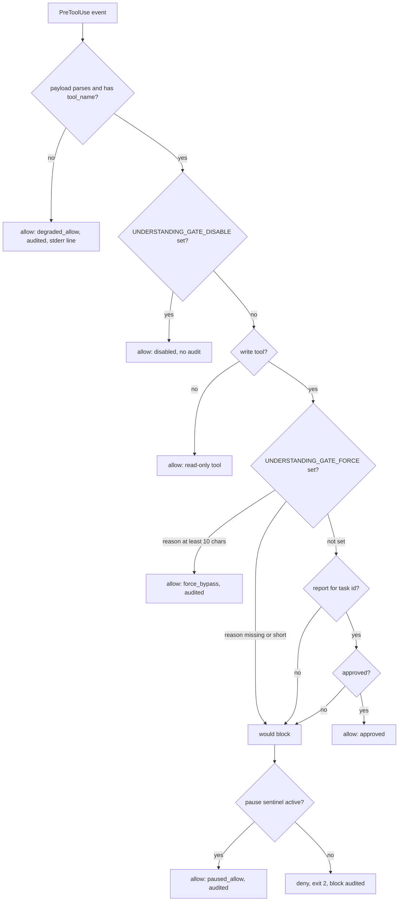

# When does the block actually fire?

What the Layer-2 enforcement hook does for a cooperative agent, an aggressive prompt, and a non-cooperative or prompt-injected agent.

The flowchart shows the order in which the Claude Code `PreToolUse` hook reaches its decision, and which outcomes write an audit entry.

**Cooperative agent + cooperative prompt:** rarely. The agent reads the Layer-1 template, emits its report, and waits for confirmation, so write tools never get attempted in the first place. The Layer-2 hook still runs on every tool call, but stays silent (read-only allowed; no audit entry).

**Cooperative agent + aggressive prompt** ("do it now, no waiting"): often. The agent may try to edit before the report cycle closes; Layer 2 then denies with a clear deny-reason and writes a `block` event to the audit log. The agent typically reads the deny-reason and falls back to producing the report.

**Non-cooperative or prompt-injected agent:** this is the case Layer 2 exists for. Every destructive tool call is denied as long as no approved report exists and no pause sentinel is active. The audit log is the trail you'll go back to in an incident review.

Two routes through Layer 2 without an approved report: force-bypass with `UNDERSTANDING_GATE_FORCE=1` + a `UNDERSTANDING_GATE_FORCE_REASON` of at least 10 characters, or an active pause sentinel (see [Pause sentinel](pause-sentinel.md)). Both are audit-logged: force-bypass as a `force_bypass` entry, a pause overriding what would otherwise have been a block as a `paused_allow` entry. A force-bypass under an active pause keeps its own `force_bypass` audit entry. Any force attempt with a missing/short reason is also audit-logged, as a `block` (or as `paused_allow` while a pause sentinel is active).

Three payload classes are allowed before any of these checks, with a stderr line and a `degraded_allow` audit entry, also when `UNDERSTANDING_GATE_DISABLE` is set: an empty payload, a payload that is not a JSON object, and a payload without a `tool_name`.
